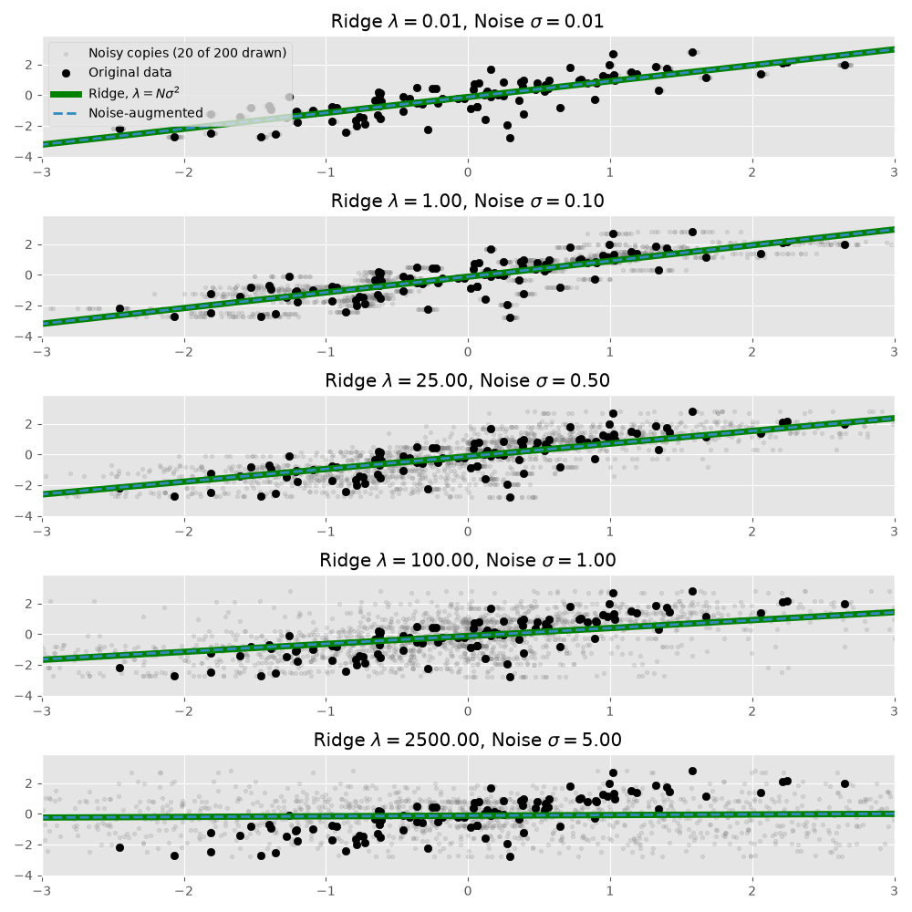

Marginalizing Multiplicative Noise Applied to Regression Predictors is Ridge Regression
---------------------------------------------------------------------------------------

This repository contains the code and figures for the post [Marginalizing Multiplicative Noise Applied to Regression Predictors is Ridge Regression](https://madrury.github.io/noisy-regression/).

Fitting a least squares regression to many stacked copies of a data set, each copy with independent multiplicative N(1, σ²) noise applied to the predictors, converges to the ridge regression with penalty λ = Nσ² as the number of copies grows.

To regenerate every figure (the random seed is fixed, so the output is reproducible):

    uv run make_figures.py

  - `ridge.py`: Ridge regression with a single predictor, and fits to noisy copies of a data set.
  - `plots.py`: Plotting functions.
  - `make_figures.py`: Draws each figure in the post into `img/`.
